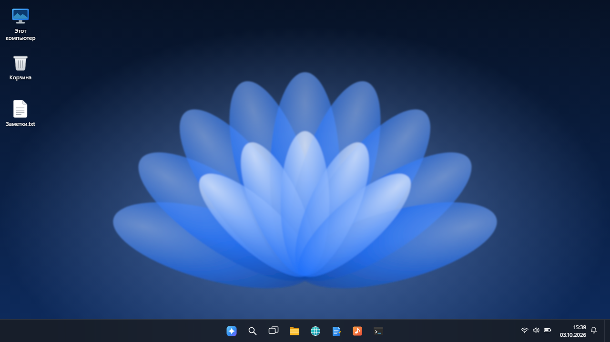
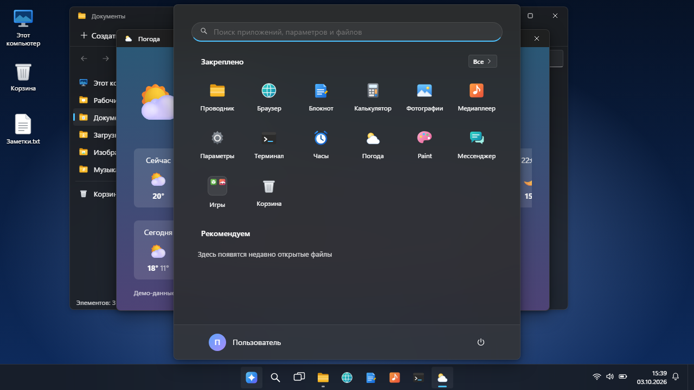

<div align="center">

# WindowsDemo - оболочка в стиле Windows 11

**Оболочка в стиле Windows 11, которая целиком работает в браузере: без сервера, без интернета, без картинок и шрифтов из настоящей системы. Значки, обои и приложения нарисованы кодом этого репозитория.**

[**▶ Открыть онлайн →**](https://alexalesha.github.io/WindowsDemo/) &nbsp;·&nbsp; [English version of this file](README.md)

[](#) [](LICENSE) [](https://developer.mozilla.org/docs/Web/HTML) [](https://alexalesha.github.io/WindowsDemo/) [](https://claude.com/claude-code)

Код, тесты и документация этого проекта написаны Claude (Anthropic) в Claude Code. Идеи, проверка и решения - Алексей.

</div>

> Фан-концепт интерфейса. Не связан с Microsoft и не одобрен ею. Windows - товарный знак Microsoft Corporation.





## Что умеет

- Окна ведут себя как окна: двигаются, меняют размер, прикрепляются к половинам и углам экрана, сворачиваются и разворачиваются; представление задач, уведомления.
- «Пуск» с поиском, списком всех приложений и папкой «Игры»; панель задач с часами и значками.
- Файлы хранятся в браузере (IndexedDB): Проводник с перетаскиванием, вырезать-вставить, импорт с диска, область просмотра, Корзина.
- Приложения: Блокнот, Калькулятор, Параметры (тема, акцент, обои, прозрачность, формат времени - на всю систему), Браузер со встроенными страницами, Фотографии, Медиаплеер (синтезированная музыка), Часы, Погода (демо-данные), Терминал, Paint и Мессенджер.
- **Игры:** десять игр сборника [Hub](https://github.com/ALEXalesha/ALEXalesha.github.io) открываются
  в окне: «Кубический мир», «Блоксити», «Операция: Периметр», Horizon Drift, «Дино-бег», «Прыг-скок»,
  «Огненные джунгли», «Космический стрелок», «Блоки» и «Судоку». Каждая - свой репозиторий: на
  GitHub Pages окно загружает `../../<репозиторий>/` того же сайта (например,
  [AlexMine](https://alexalesha.github.io/AlexMine/)). У себя положите клоны игр рядом с этим
  репозиторием. Игра в свёрнутом или неактивном окне стоит на паузе (протокол - в
  `_os-shared/README.md`).


Оболочка лежит в `win11_3/`, собирается из `win11_3/src/` командой `node win11_3/src/build.js`. `index.html` в корне просто открывает её.


## Запуск у себя

Откройте `index.html` или `win11_3/index.html` в Chrome, Edge или Firefox.

## Проверки

Законы Playwright в `tests/` открывают страницу по файловому адресу в безголовом Chromium, по
одной за раз:

```
npm install
npx playwright install chromium
npm test
```

Проверки окон игр идут, только если репозитории игр лежат рядом с этим, иначе они пропускаются.
Захват мыши в проверках всегда поддельный. `npm run screenshots` делает кадры выше.

## История

Оболочка сделана в сборнике [Hub](https://github.com/ALEXalesha/ALEXalesha.github.io) (папки `web/win11_3` и `web/_os-shared`). Здесь она лежит с историей коммитов, начиная после первого «сырого» импорта (в нём ещё был знак загрузки из четырёх квадратов, как у Windows); стартовая страница, таблица отдельно опубликованных игр и проверки добавлены для этой публикации.

## Лицензия

MIT, см. [LICENSE](LICENSE).
